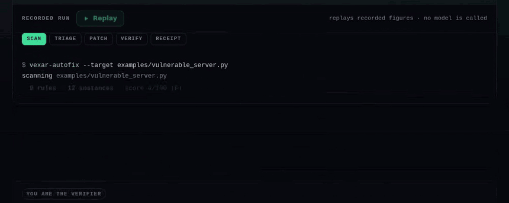
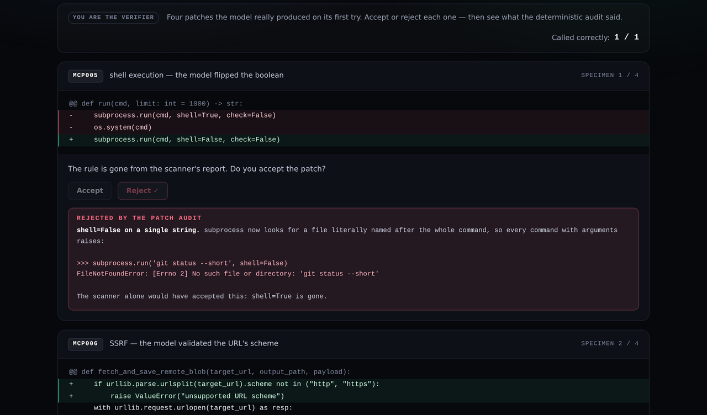

<div align="center">

# vexar-autofix

**An MCP security agent that can prove it fixed your code.**

Every AI code agent asks you to trust its diff. This one hands you a receipt.

[](https://github.com/RANJITHROSAN17/vexar-autofix/actions/workflows/ci.yml)
[](tests)
[](pyproject.toml)
[](LICENSE)

[**Live demo**](https://RANJITHROSAN17.github.io/vexar-autofix/) ·
[play the verifier](https://RANJITHROSAN17.github.io/vexar-autofix/#verifier) ·
[how it works](#how-it-works) ·
[run it](#quickstart)

<sub>Submission for the **Nebius × NVIDIA Global AI Hackathon** — Coding and Agentic Engineering track.<br>
Built with **NVIDIA Nemotron** on **Nebius Token Factory**.</sub>

</div>



---

## The claim, and how it is enforced

Most "AI fixes your code" demos ask you to believe the output. The interesting engineering here is
not the patch — it is the **adversary that checks it**.

| The claim | How it is actually enforced |
|---|---|
| It fixed the finding | The **same scanner that found it** must report fewer instances for that tool |
| It broke nothing | No rule may gain an instance anywhere in the file |
| It still works | The target's own **pytest suite** must pass after the patch |
| It did not just silence the rule | A **deterministic patch audit** rejects remedies that cannot work |
| It is honest about what it skipped | Every finding lands in exactly one bucket: fixed, unfixed, refused, skipped |

A patch is accepted only when all of that agrees. Otherwise it is rejected, the reason is recorded,
and the **failure text** — not a summary of it — is handed to a stronger model for the next attempt.

---

## The receipt

Real runs over three hand-written fixtures with a **declared** rule set, so the denominator is known
rather than estimated. Produced by `python eval/run_eval.py` with NVIDIA Nemotron on Nebius Token Factory.

| Fixture | Findings | Fixed | Refused | Regressions | Score |
|---|--:|--:|--:|--:|--:|
| [`vulnerable_server.py`](examples/vulnerable_server.py) | 9 rules / 12 instances | **4** | 7 | **0** | 4 → 46 |
| [`helper_delegation_server.py`](examples/helper_delegation_server.py) | 3 rules / 3 instances | **3** | 0 | **0** | 73 → **100** |
| [`clean_server.py`](examples/clean_server.py) *(control)* | 0 | 0 | 0 | **0** | **100**, untouched |

**18 model calls · $0.0226 · 7 verified fixes · 0 regressions** — recorded 2026-10-28 at commit
`30313a1`, and every number on the [demo page](https://RANJITHROSAN17.github.io/vexar-autofix/)
carries that timestamp. The scanner half of the receipt is regenerated from the pinned scanner
commit and committed as [`docs/data/scan.json`](docs/data/scan.json), so it reproduces identically
on any machine.

> The vulnerable fixture still scores **F** after being fixed. That is not a bug: the seven refusals
> are findings too, and the report refuses to hide them to make a number look better.

---

## Quickstart

**No API key needed to see the machinery.** The whole pipeline runs offline against a scripted mock:

```bash
git clone https://github.com/RANJITHROSAN17/vexar-autofix
cd vexar-autofix
pip install -e .      # pulls the scanner from GitHub, pinned to a commit, not a branch

# Rehearsal: no network, no model, no key. Clearly labelled fake output.
vexar-autofix --target examples/vulnerable_server.py --provider mock --rehearse-accept
```

**With a real model** (an API key from [tokenfactory.nebius.com](https://tokenfactory.nebius.com)):

```bash
export NEBIUS_API_KEY=...            # never commit this, never paste it into an issue

vexar-autofix --preflight            # key valid? endpoint right? routed models exist?
vexar-autofix --target examples/vulnerable_server.py          # dry run, prints the diff
vexar-autofix --target examples/vulnerable_server.py --apply   # write the verified patch
```

`--preflight` exists because a wrong region and a wrong key both surface as a confusing error
mid-run, and at hackathon time that difference costs hours.

<details>
<summary><b>All flags</b></summary>

| Flag | Meaning |
|---|---|
| `--target PATH` | File to audit and patch |
| `--provider {nebius,mock}` | Real Token Factory client, or the offline rehearsal |
| `--apply` | Write the verified patch back (dry run by default) |
| `--max-attempts N` | Attempts per finding before it is left unfixed (default 3) |
| `--no-tests` | Skip the target's test suite |
| `--json` | Emit the full report as machine-readable JSON |
| `--rehearse-accept` | Mock only: replay a known-good patch to exercise the accept path |
| `--preflight`, `--list-models` | Validate key, find the working endpoint, confirm the models exist |

</details>

---

## Verify it in 60 seconds, without a key

The whole project argues that claims should be checkable, so the repo is built to be checked:

```bash
python -m pytest -q          # 46 tests, no network, no key
```

```bash
# Reproduce the deterministic half of the receipt yourself:
python - <<'PY'
from pathlib import Path
from mcp_doctor import ScanConfig, scan_paths
for name in ("vulnerable_server.py", "helper_delegation_server.py", "clean_server.py"):
    report = scan_paths([Path("examples") / name], ScanConfig())
    rules = sorted({d.rule_id for d in report.diagnostics})
    print(f"{name:30}{len(report.diagnostics):>3} findings{report.summary.score:>4}/100  {len(rules)} rules")
PY
```

```
vulnerable_server.py           12 findings   4/100  9 rules
helper_delegation_server.py     3 findings  73/100  3 rules
clean_server.py                 0 findings 100/100  0 rules
```

```bash
python eval/run_eval.py --provider mock   # the pipeline, offline; numbers are fake by design
python eval/run_eval.py                   # the real thing (needs NEBIUS_API_KEY)
```

---

## Why this exists

MCP servers are how LLM agents touch the real world: they run shell commands, fetch URLs, read and
write files, query databases on an agent's behalf. Static scanners find those sinks — but they
cannot fix them.

The obvious next step, "point an LLM at the file", creates a worse problem than it solves: you now
have a diff written by something that will confidently claim it worked. A scanner can confirm the
*pattern* is gone. Only a human — or a deterministic rule — can tell whether the **behaviour** was
preserved.

So the pitch is not "an agent that fixes security bugs". It is: **a loop in which a model's output
cannot be accepted on its own authority.**

---

## How it works

```
        target file
             │
             ▼
      ┌──────────────┐  findings   ┌────────────────┐
      │   scanner    │────────────▶│     triage     │  Nemotron-3 Nano  30B A3B
      │  (Vexar-MCP) │             │ exploitable,   │  one cheap call per finding
      └──────────────┘             │ or guarded?    │
             ▲                     └───────┬────────┘
             │                             │ confirmed + autofixable
             │                             ▼
             │                     ┌────────────────┐
             │                     │  patch author  │  Nemotron-3 Super 120B A12B
             │                     └───────┬────────┘
             │                             │ exact anchor edits
             │                             ▼
             │                     ┌────────────────┐   verification failed
             └─────────────────────│    VERIFIER    │──────────▶ Nemotron-3 Ultra 550B A55B
               targeted count ↓    │  rescan        │            + the exact failure reason
               no new findings?    │  patch audit   │
               tests still pass?   │  pytest        │
                                   └───────┬────────┘
                                           │ all three agree
                                           ▼
                                   verified patch + receipt
```

The scanner sits on **both sides** of the agent. It is the oracle the model cannot argue with.

### The routing signal is the unusual part

Tiered demos usually route on **request difficulty** — a quantity nobody can measure before
answering. This routes on **verified failure**: a signal that only exists because a deterministic
checker is in the loop. The expensive model is never consulted on a guess, and it never has to work
out what went wrong — the verifier tells it, in the words it will be graded against.

---

## Three properties that make this safe on a real repository

**1. Edits are exact anchor replacements — never line numbers, never a whole-file rewrite.**
A patch either matches the source byte-for-byte or fails loudly. The model cannot silently
reformat, reorder, or delete code it was not asked to touch.

**2. Your working tree is never modified until a patch has already verified.**
Every attempt runs against a throwaway copy in a temp directory. `--apply` is the only thing that
writes, and it writes a patch the verifier has already approved.

**3. One finding per attempt.**
Each accepted patch is small enough to review, a failure is attributable to a single change, and
partial progress survives a finding the model cannot solve. One giant patch for every finding fails
as a unit and takes the good work down with it.

---

## The verifier, in three stages

| Stage | Question it answers | Cost |
|---|---|---|
| **Rescan** | Did the targeted rule's instance count actually *drop*, with no new finding anywhere? | free |
| **Patch audit** | Does the added code implement the remedy, or does it merely silence the rule? | free |
| **Tests** | Does the target's own suite still pass? | free |
| **Escalation** | (on failure) Here is exactly why — now try again on a stronger model | paid |

### It is line-shift invariant

The first version compared findings by `(rule, tool, line)`. A patch that deleted two lines and
added one renumbered everything below it, so a *perfect* fix reported "1 finding cleared, 6 new
findings appeared" and was rejected — every correct multi-line patch would have failed.

It now compares **rule-instance counts per tool**, which survives reformatting and reordering, and
requires the targeted rule's count to actually drop. Moving a sink to a different line is not
remediation.

> Pinned by `tests/test_verifier.py::test_line_shift_is_not_a_new_finding` — the bug is a test, not a memory.

### It audits the patch, not just the rule count

On the first live run the model produced four patches. The scanner accepted all four. **Three were
wrong**, because the scanner matches patterns, not intentions:

| Rule | What the model wrote | What it actually did |
|---|---|---|
| `MCP005` | `subprocess.run(cmd, shell=False)` | Flipped the boolean instead of building an argv list. subprocess then looks for a file literally named after the whole command, so **every command with arguments raises `FileNotFoundError`** |
| `MCP006` | validated the URL's scheme | Prevents nothing. `http://169.254.169.254/latest/meta-data/` has a valid scheme *and* a valid host |
| `MCP007` | `resolved.startswith(BASE_DIR)` | String prefix confinement: `/app-evil/secret` passes a check against `/app` |

So verification gained a third deterministic stage. It reads **only the lines a patch added** —
never the existing file, so pre-existing code cannot trigger a rejection — and rejects remedies that
cannot work:

```python
# verifier.py — each pattern is checked against added lines only
SMELLS = {
    "MCP005": ((r"shell\s*=\s*False", "passing the command as one string; pass an argv list"),),
    "MCP007": ((r"startswith\s*\(", "'<base>-evil' passes a check against '<base>'"),),
}

# A remedy is only credible if the patch names the mechanism that makes it work.
REMEDY_MARKERS = {
    "MCP006": (
        r"(ALLOWED_HOSTS|allowlist|hostname\s*(not\s+)?in\s)",
        "validating the scheme does not prevent SSRF",
    ),
}
```

This is another rule, not another opinion: it costs nothing, cannot hallucinate, returns the same
verdict twice, and can be read and argued with by the person reviewing the diff.

**Rejection is fail-closed.** A retry costs a fraction of a cent; a wrong patch costs trust in every
other patch the tool produces.

### Deleting the dangerous call is reported, not blocked

Sometimes deletion is right; sometimes it silently drops functionality. No mechanical check can tell
which, so it raises a **review note** next to the diff and lets a human decide. That path also caught
a second real bug: the review step compared the patched text with itself after the variable had
already been reassigned, so it silently reported nothing, forever.

---

## What it fixes — and what it deliberately refuses

| Rule | Meaning | Autofixed |
|---|---|---|
| `MCP005` | `shell=True`, `os.system`, `eval` on tool input | ✅ argv form (`shlex.split(cmd)`) |
| `MCP006` | SSRF sink with no host allowlist | ✅ explicit host allowlist |
| `MCP007` | Filesystem path from tool input, unconfined | ✅ `resolve()` + `is_relative_to` |
| `MCP010` | Outbound HTTP without an explicit timeout | ✅ `timeout=` |
| everything else | contract, schema, naming, token budget | ❌ reported, left to a human |

The refusal list is the more important one. `MCP001` (a tool description is too short) has no
mechanical fix, and a model guessing at the author's intent produces a diff that looks plausible and
is wrong. **A confidently wrong fix is worse than a known finding**, so the agent says so and moves
on — and the report has a `refused` bucket so a skipped finding is never invisible.

---

## Models and routing

[Token Factory's](https://tokenfactory.nebius.com) OpenAI-compatible endpoint is the only inference
provider in this project. Three Nemotron tiers, each with a different job — not the same job at a
different price:

| Role | Model | When it runs | Why this tier | $/1M in/out |
|---|---|---|---|---|
| **Triage** | `nvidia/NVIDIA-Nemotron-3-Nano-30B-A3B` | Once per finding, every scan | Classification, not reasoning — and it runs on every finding | 0.06 / 0.24 |
| **Patch** | `nvidia/nemotron-3-super-120b-a12b` | Once per queue entry | Real code understanding at a price where trying is affordable | 0.30 / 0.90 |
| **Escalate** | `nvidia/Nemotron-3-Ultra-550b-a55b` | Only after a *failed* verification | It receives the rejected patch and the failure reason — actual evidence to reason about | 1.00 / 3.00 |

Override any tier without touching code:

```bash
AUTOFIX_MODEL_TRIAGE=...  AUTOFIX_MODEL_PATCH=...  AUTOFIX_MODEL_ESCALATE=...
```

The client is stdlib `urllib`, not the OpenAI SDK: the scanner underneath is dependency-free, and
the agent should not be the thing that changes that.

---

## Nebius stack: what is used, and where it pays

Everything that reasons runs on **Nebius Token Factory**, through one OpenAI-compatible endpoint.
There are three NVIDIA open-source Nemotron models, and the routing between them is the design
decision, not a wrapper:

- **`nvidia/NVIDIA-Nemotron-3-Nano-30B-A3B`** — one call per *finding*. This is the highest-volume
  job in the system, so it runs on the cheapest tier. A scan of ten findings makes ten of these
  calls and no expensive ones.
- **`nvidia/nemotron-3-super-120b-a12b`** — one call per *queued finding*, i.e. only what survived
  triage as mechanically fixable.
- **`nvidia/Nemotron-3-Ultra-550b-a55b`** — only after a **verification already failed**, and it
  receives the rejected patch plus the reason it was rejected. It is paid for exactly when cheap
  reasoning has demonstrably not worked.

Where Token Factory accelerated the work: it collapses what would otherwise be three vendor
integrations and three key-handling paths into one endpoint and one `NEBIUS_API_KEY`, and its
per-token pricing is what makes calling a model **per finding** affordable at all. The alternative —
one large model for every decision — either costs too much to run on a whole repository or forces
you to batch decisions and lose the per-finding verdict. `--preflight` exists because a wrong key
and a wrong endpoint both present as the same confusing failure mid-run, and at hackathon time
that difference costs hours.

**Infrastructure used: none beyond the API.** No GPU instance was provisioned, no model was
deployed or served, and there is no scaling configuration to tune — Token Factory is reached over
plain HTTPS as a serverless API, and the tier is chosen by model ID at runtime, so changing capacity
is a string rather than a deployment.

**Other Nebius tools and services: none.** No Nebius Serverless Endpoints, no managed vector
store, no hosted database. All state is a file in this repository — `docs/data/runs.json` holds the recorded
run, committed so it can be inspected rather than taken on trust. If a later version adds a Nebius
service, this paragraph changes in the same commit.

The offline rehearsal (`--provider mock`) uses none of this, which is why the pipeline can be
inspected end to end without a key or a network call.

---

## Measuring it

Claims about an AI agent are cheap, so each fixture declares the **exact** rule set it contains.
The eval exits non-zero on **any** regression — if a patch ever trades one finding for another, CI
goes red instead of the demo looking good.

```bash
python eval/run_eval.py                  # real models
python eval/run_eval.py --provider mock  # offline rehearsal, clearly labelled fake
python eval/run_eval.py --case vulnerable_server.py --json
```

```
fixture                          found  queued  fixed  refused  regress  score
------------------------------------------------------------------------------
vulnerable_server.py                 9       4      4        7        0  4 -> 46
helper_delegation_server.py          3       3      3        0        0  73 -> 100
clean_server.py                      0       0      0        0        0  -

18 model calls, ~$0.0226

OK: ground truth matched, zero regressions
```

### Run against real code, not only fixtures

A scanner that only fires on the deliberately-vulnerable fixture proves nothing. Run against
[Nebius's own MCP server](https://github.com/nebius/mcp-server) (Python, MIT, 4 tools, 8 files): it
scores **94/100 (A)** with **no security findings** — the single observation is a context-budget
warning (`MCP002`, one tool description consumes ~659 tokens against a 250-token budget). A tool
that never says "this code is fine" is not a scanner, it is a sales pitch.

---

## The demo page

[**RANJITHROSAN17.github.io/vexar-autofix**](https://RANJITHROSAN17.github.io/vexar-autofix/)

It is deliberately static: a browser cannot hold an API key without exposing it, so the page shows
**recorded** runs rather than a live button. What is on it:

- the receipt, per fixture, with every figure timestamped and tied to a commit;
- **"You are the verifier"** — four real patches the model produced, accept or reject each, then see
  what the deterministic audit said and why;
- a **replay** of each run, stage by stage, that calls nothing;
- a scan-detail drawer generated straight from the pinned scanner.



There is also a **[live Space demo](demo/)** (`demo/app.py`) that runs the pipeline for real against
the three bundled fixtures, and refuses to be pointed at anything else.

---

## The demo video

Two minutes, narrated over the recorded run: the vulnerable line, the scanner's own
output, the three wrong patches, the `FileNotFoundError`, the third stage that catches
them, and the second run that gets it right.

The visuals are generated from this repository — so they cannot drift from the data,
and the frame says **not a live run** rather than pretending to be a terminal capture:

```bash
pip install pillow imageio-ffmpeg
python video/render.py --beats                                   # the 26-beat sheet
python video/render.py --audio narration.mp4 --out demo.mp4      # render it
```

`video/render.py` holds the beats, the captions and the palette. The audio track is
passed through untouched; only the visuals are produced here. Every panel body is output
captured from the run recorded in [`docs/data/runs.json`](docs/data/runs.json).

---

## Repository map

```
src/vexar_autofix/
  agent.py        scan → triage → patch → verify → escalate, with the working tree untouched
  verifier.py     the oracle: rescan, line-shift-invariant diffing, patch audit, tests
  clients.py      Token Factory client (stdlib urllib), model tiers, prices, usage accounting
  prompts.py      triage + patch prompts, versioned as reviewable artefacts
  cli.py          CLI, --preflight, JSON reports
  models.py       Finding, Verdict, Edit, Attempt, Verification, Usage

examples/         three hand-written MCP servers: vulnerable, helper-delegation, clean (control)
eval/run_eval.py  ground-truth measurement; exits non-zero on any regression
tests/            46 tests, no network or key required
docs/             the static demo page + recorded run data
ROADMAP.md        the verified 90-day plan: gaps, dates, invariants, non-goals
scripts/          capture_demo.py — regenerates docs/data/runs.json inside GitHub Actions
```

---

## Limitations, stated plainly

- **Four rules are autofixed.** The other scanner rules are reported, not repaired. This is a
  deliberate scope, not a roadmap gap — the refusal is a feature.
- **Verification is pattern-level plus tests.** A patch can pass all three gates and still be
  semantically wrong if the codebase has no tests covering that path. The gates raise the floor; they
  do not replace review.
- **One file at a time**, one finding per attempt. Cross-file fixes are out of scope.
- **The demo page is recorded.** Model output is not simulated, but it is also not live — every
  figure carries the timestamp and commit that produced it.
- **`--apply` on a bundled fixture will rewrite it**, which invalidates the eval's ground truth. The
  CLI warns and prints the `git restore` command when you do it.

```bash
# Everything the receipts claim, checked by someone who does not trust either of us:
python -m pytest -q && python eval/run_eval.py --provider mock
```

---

## Security

- The API key is read from `NEBIUS_API_KEY` and is never written to disk, logged, or reported.
- `.github/workflows/ci.yml` includes a credential scan that fails the build if a key-shaped string
  is committed.
- The demo endpoint is restricted to the three bundled fixtures, so a public URL cannot be turned
  into a free general-purpose code-fixing service.

---

<div align="center">
<sub>MIT · built by <a href="https://github.com/RANJITHROSAN17">Ranjith Rosan</a> for the Nebius × NVIDIA Global AI Hackathon</sub><br>
<sub>Scanner: <a href="https://github.com/RANJITHROSAN17/Vexar-MCP">Vexar-MCP</a>, pinned to commit <code>dd4c07b</code> so a judge's run reproduces today's verification behaviour</sub>
</div>
